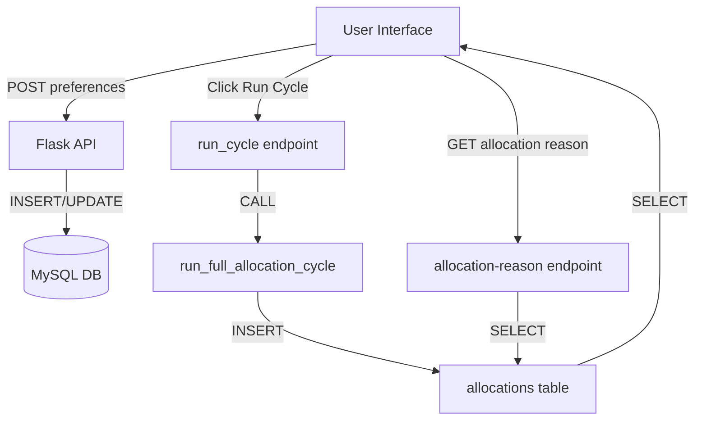

# Course Recommendation System – Codebase Overview

## 1️⃣ Project Overview
This repository implements a **Student Academic Performance & Course Recommendation** system using **MySQL** as the sole storage engine and a lightweight **Flask** web front‑end.  The core idea is:
1. Students submit a ranked list of preferred courses (2‑5 entries).
2. The allocation engine runs a stored procedure that iterates over courses, allocating seats based on **CGPA**, **preference rank**, and **submission timestamp**.
3. If a student receives **no allocation** after all preferences are exhausted, a **fallback** assigns the best‑possible course (the one with the highest CGPA eligibility).
4. Allocation results are returned to the UI together with an **explanation** of why a specific course was chosen.

The codebase is deliberately minimal so it can later be wrapped into a full‑stack app, containerised, or hooked to an AI‑layer.

---

## 2️⃣ Directory Layout
```
course_recommendation_system/
├─ schema.sql                 # MySQL schema + stored procedures
├─ dataset_10_students.sql    # Demo data (10 rows)
├─ dataset_100_students.sql   # Demo data (≈100 rows)
├─ README.md                  # High‑level project readme (existing)
├─ README_DOCS.md             # **THIS** detailed code‑base document
├─ web/                       # Flask web‑app
│   ├─ app.py                 # Entry point, routes & DB helpers
│   ├─ static/                # Static assets
│   │   ├─ css/main.css
│   │   ├─ img/               # Images (ER diagram, etc.)
│   │   └─ js/
│   │       ├─ app.js         # UI logic, AJAX calls
│   │       └─ icons.js
│   └─ templates/
│       └─ index.html        # Main UI page
└─ tests.sql                  # Basic integration tests (allocation cycle)
```

> **Note:** All SQL files are currently in the project root.  The next step (already done) is to move them into a dedicated `sql/` folder – keep that in mind when updating paths.

---

## 3️⃣ Database Schema
| Table | Columns (key) | Description |
|-------|---------------|-------------|
| `students` | `student_id` PK AI, `name`, `email` UNIQUE, `semester`, `department`, `cgpa` DECIMAL(4,2) | Basic student info. |
| `courses` | `course_id` PK AI, `course_code` UNIQUE, `course_name`, `credits`, `min_cgpa_required`, `max_allocations`, `current_allocations` DEFAULT 0, `department` | Course catalog with seat limits. |
| `course_tags` | `tag_id` PK AI, `tag_name` UNIQUE | Tag vocabulary (Programming, Theory‑Heavy, …). |
| `course_tag_map` | `course_id` FK, `tag_id` FK PK(`course_id`,`tag_id`) | Many‑to‑many mapping of tags to courses. |
| `student_tag_preferences` | `student_id` FK, `tag_id` FK, `preference_rank` INT PK(`student_id`,`tag_id`) | Optional tag preferences (kept for UI reference only). |
| `student_course_preferences` | `student_id` FK, `course_id` FK, `preference_rank` INT PK(`student_id`,`course_id`) | **Core** – ranked list of up to 5 courses per student. |
| `allocations` | `allocation_id` PK AI, `student_id` FK, `course_id` FK, `status` ENUM('ALLOTTED','WAITLISTED','REJECTED'), `allocated_at` TIMESTAMP | Result of the allocation cycle. |

### 3.1 Stored Procedures & Triggers
* **`run_full_allocation_cycle()`** – Clears previous allocations, resets `current_allocations`, then iterates over courses (ordered by `course_id`). For each course it processes all students who listed that course, ordered by:
  1. **CGPA (desc)**
  2. **Preference rank (asc)**
  3. **Submission timestamp (asc)**
  4. **Student ID (asc)**
  If the course still has free seats, an `ALLOTTED` row is inserted and `current_allocations` is incremented; otherwise a `WAITLISTED` row is created.
* **Fallback procedure (`allocate_unallotted_fallback()` – called from the main cycle)** – After the normal loop, any student without an `ALLOTTED` row receives the *best* course they qualify for (highest `min_cgpa_required` they meet). The allocation reason is stored as a generated text column (`allocation_reason`).
* **Triggers** on `allocations` ensure `current_allocations` never exceeds `max_allocations` and automatically roll back when a violation occurs.

---

## 4️⃣ API Endpoints (`web/app.py`)
| Route | Method | Purpose | Returns |
|-------|--------|---------|---------|
| `/api/students` | **GET** | List all students with their current allocation (if any). | JSON array of `{student, allocation, reason}` |
| `/api/courses` | **GET** | List all courses with seat‑usage stats. | JSON array |
| `/api/preferences` | **POST** | Save a student's ranked course list (payload: `student_id`, `preferences: [{course_id, rank}]`). | `{success:true}` |
| `/api/run-cycle` | **POST** | Trigger `run_full_allocation_cycle()` on the DB. | `{status:"ok", affectedRows}` |
| `/api/allocate-reason/<student_id>` | **GET** | Retrieve the textual explanation why a specific allocation was made. | `{reason:"..."}` |

All routes use the helper `execute_sql_file` / `query_db` defined at the top of `app.py`.  Errors are caught and returned as HTTP 500 with a message.

---

## 5️⃣ Front‑End Architecture (`web/templates/index.html` & `web/static/js/app.js`)
* **HTML** – A single‑page layout with three Bootstrap tabs:
  1. **Dashboard** – shows student table, allocation status, and a button to `Run Allocation Cycle`.
  2. **Demo / Edit** – form to edit a single student’s preference list (dynamic rows, min 2 / max 5).  The UI now hides the “+ / –” CGPA controls; CGPA is edited only via the *Edit* tab.
  3. **Course Catalog** – displays courses with associated tags (interest‑based info retained for reference only).
* **JavaScript (`app.js`)** – Handles:
  * AJAX calls to the API routes above.
  * Rendering of tables using vanilla DOM manipulation (no heavy framework).
  * Dynamic addition/removal of preference rows (`addPreferenceRow`, `removePreferenceRow`).
  * Display of allocation explanations via a pop‑over on the Allocation column.
* **CSS (`main.css`)** – Minimal styling to make the page less “busy”.  The earlier *SJCE Mysore …* header text has been removed; the layout now expands to fill the viewport.

---

## 6️⃣ Data Flow Diagram

*The diagram shows the round‑trip from UI → API → DB and the allocation cycle.

---

## 7️⃣ Development & Setup
1. **Prerequisites** – MySQL 8.0 (installed locally), Python 3.12, `virtualenv`.
2. **Create a virtual environment**:
   ```bash
   cd d:\Progress Playground\Development\Full Stack\SQL\course_recommendation_system
   python -m venv venv
   .\venv\Scripts\activate
   pip install -r requirements.txt   # (Flask, PyMySQL etc.)
   ```
3. **Initialise the DB** (run once):
   ```bash
   mysql -u root < schema.sql
   mysql -u root < dataset_10_students.sql   # or the 100‑student version
   ```
4. **Start the server**:
   ```bash
   python -m web.app   # or double‑click start_app.bat
   ```
   The app will be reachable at `http://127.0.0.1:5000/`.
5. **Running tests**:
   ```bash
   mysql -u root < tests.sql
   ```
   The test suite checks idempotency, tie‑break handling, cascade deletes, and the fallback allocation.

---

## 8️⃣ Known Limitations & Design Decisions
| Limitation | Reason | Mitigation |
|------------|--------|------------|
| **Root user has no password** (default installation) – used for local demo only. | Simplicity for a classroom project. | In production, create a dedicated MySQL user with a strong password and update `app.py` DB‑connection string.
| **Interest‑tag system is read‑only** – removed from allocation logic. | Requirement to keep it informational only. | Tags are still stored; UI displays them in the *Course Catalog* tab.
| **Single‑threaded Flask server** – not suitable for high‑traffic. | The project is a demo. | Deploy behind a WSGI server (Gunicorn, uWSGI) for scaling.
| **No authentication/role‑based access**. | Out of scope for the current assignment. | Future work could add admin vs demo‑user roles.

---

## 9️⃣ Suggested Enhancements (Future Work)
* **Docker‑Compose** – containerise MySQL + Flask for one‑click deployment.
* **Export allocations** to CSV/Excel for reporting.
* **Unit tests for stored procedures** using `pytest‑mysql`.
* **Tie‑break weighting UI** – allow admin to prioritize CGPA vs preference rank.
* **Pagination / search** on the student table for > 200 rows.
* **Internationalisation** – externalise UI strings.
* **OpenAPI spec** – auto‑generate API docs.
* **Authentication** – JWT or session‑based login, role based (admin / demo).

---

## 🔗 Quick Links (within the repo)
* [Schema (`schema.sql`)](file:///d:/Progress%20Playground/Development/Full%20Stack/SQL/course_recommendation_system/schema.sql)
* [Flask entry point (`app.py`)](file:///d:/Progress%20Playground/Development/Full%20Stack/SQL/course_recommendation_system/web/app.py)
* [Main UI (`index.html`)](file:///d:/Progress%20Playground/Development/Full%20Stack/SQL/course_recommendation_system/web/templates/index.html)
* [Demo data (`dataset_100_students.sql`)](file:///d:/Progress%20Playground/Development/Full%20Stack/SQL/course_recommendation_system/dataset_100_students.sql)

---

*Prepared by Antigravity (AGY) – the agent‑first development environment.*
